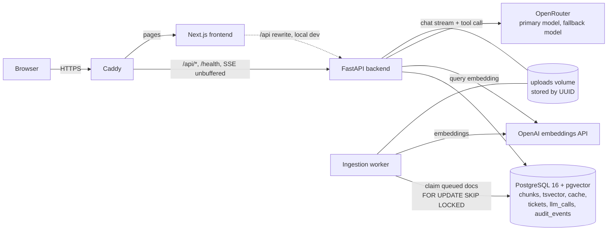
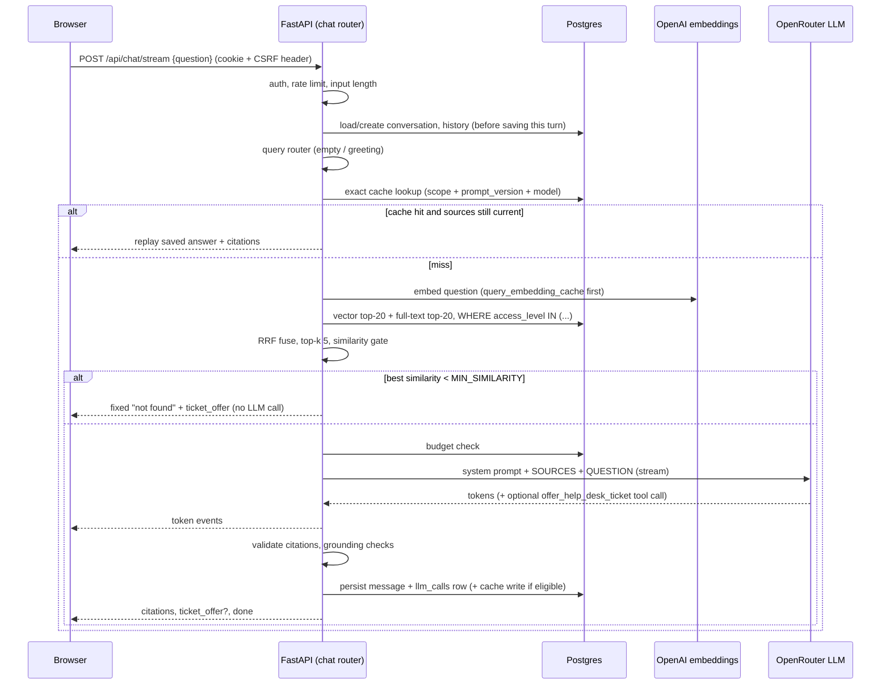

# Architecture

Ask Onboarding is a RAG app: employees ask questions, the system retrieves passages from uploaded documents the user is allowed to read, and an LLM answers **only** from those passages with validated citations. When the documents don't contain the answer, it says so and offers a ticket.

Numbers in this document come from [docs/eval.md](docs/eval.md) (fake embedder, fake LLM) or from the playbook's scaling assumptions. Where something is an estimate or untested, it says so.

## Components

One Postgres holds everything: vectors (HNSW), full-text (GIN on `tsv`), users, documents, the answer cache, tickets, and the audit tables. One database means chunk swaps and cache invalidation are plain transactions.

## One question, end to end

## 1. How it works today

Path of one question, with the file that owns each step:

1. **Browser → proxy.** In production Caddy (`Caddyfile`) sends `/api/*` straight to FastAPI with `flush_interval -1` so SSE is not buffered, and everything else to Next.js. Locally, `frontend/next.config.ts` rewrites `/api/*` to the backend. The browser never sees an API key.
2. **Auth, CSRF, rate limit.** `security.py::require_user` verifies the signed session cookie; `require_csrf_header` demands `X-Requested-With`; `security_hardening.py` applies the per-user in-memory limit (`RATE_LIMIT_CHAT_PER_MINUTE`).
3. **Orchestration.** `services/answer_service.py` runs the steps in order and delegates to `single_flight_dispatch.py` → `answer_generation.py` → `answer_persistence.py` (split only to keep files short).
4. **Query router** (`services/query_router.py`): empty, too-long, or small-talk input gets a fixed reply with no retrieval and no LLM call.
5. **Exact answer cache** (`services/cache_service.py`): key = hash of the normalised question + access scope + `prompt_version` + model. On a hit, every `(document_id, version)` the answer depended on is re-checked; stale entries are invalidated and treated as a miss. Follow-up questions are never cached.
6. **Retrieval** (`retrieval/`): `vector_search.py` (cosine, `1 - (embedding <=> query)`), `keyword_search.py` (`websearch_to_tsquery` + `ts_rank_cd`), `rrf.py` (`Σ 1/(60+rank)`), `hybrid.py` glue. Both queries filter `access_level` **inside SQL** using `security.py::allowed_access_levels`.
7. **No-answer gate** (`retrieval/gate.py`): best vector similarity below `MIN_SIMILARITY` → fixed "not found" response plus a ticket offer; the LLM is not called.
8. **Budget check** (`services/budget_service.py`): over the per-user token cap or global USD cap → degraded "Relevant passages" response instead of a generated answer.
9. **Prompt build** (`llm/prompts.py`): static system prompt v1 first, numbered `<source>` blocks with `</source>` escaped, last 4 history turns, sources truncated to `MAX_CONTEXT_TOKENS`.
10. **LLM stream** (`llm/openai_compatible_client.py`, wrapped by `llm/fallback.py` and `llm/circuit_breaker.py`): primary model, then `LLM_FALLBACK_MODEL` on timeout/5xx/429, never on a content refusal. One tool only: `offer_help_desk_ticket` (`llm/tools.py`), which writes nothing.
11. **Validation** (`llm/grounding_check.py`, `services/citation_support.py`): citations to chunks that were not retrieved are dropped; a non-refusal with no valid citation becomes `ungrounded`; numbers, dates, URLs, emails and commands in the answer must appear in the cited chunks.
12. **SSE out** (`services/stream_events.py`, `sse-starlette`): `meta`, `token`, `citations`, `ticket_offer`, `done`, `error`. The UI parser is `frontend/src/lib/sse.ts`.
13. **Persist and audit** (`services/audit_service.py`): the message, an `llm_calls` row (full prompt, response, chunk ids and scores, tokens, cost, timings, status, cache_hit), and `audit_events` for sensitive actions.
14. **Ticket** only on a human click: `POST /api/tickets` (`services/ticket_service.py`), user taken from the session, identical open tickets within 10 minutes deduplicated.

Ingestion (separate path): `POST /api/documents` validates extension **and** magic bytes, stores the file by UUID, and queues a row. `ingestion/worker.py` claims it with `FOR UPDATE SKIP LOCKED`; `ingestion/pipeline.py` parses (`parsers.py`), chunks (`chunker.py`), reuses embeddings for unchanged chunk text, embeds the rest in batches of ≤ 64, then swaps chunks in one transaction (`_swap_chunks`). A failed re-upload leaves the previous version serving answers.

## 2. Choices

| Choice | Value | Why |
|---|---|---|
| Chunking | 500 tokens, 80 overlap, heading path kept and prepended to embedded text | Eval (fake embedder): 500/80 hit-rate@5 = 100.0% (20/20) with hybrid off and on; 300/60 with hybrid off missed one question (95.0%, 19/20). Larger chunks keep a section's context together. With hybrid on the two sizes tie. |
| Search | Hybrid (vector + full-text, RRF), `HYBRID_ENABLED=true` | MRR at 500/80: 0.760 off → 0.892 on. Exact-keyword questions (commands, port numbers) are where plain vectors lose. |
| Vector store | pgvector (HNSW, cosine) in the same Postgres | One database for vectors, full-text, ACL and audit; transactional swaps. See [ADR 001](docs/adr/001-pgvector.md). |
| Embeddings | OpenAI `text-embedding-3-small`, 1536 dims, direct (not via a gateway) | Cheap, good enough; changing it forces a full re-embed, so it is kept stable. |
| Answer LLM | OpenRouter via the `openai` SDK; primary + fallback model from env | One client, many models; fallback is a real outage story. Defaults in `.env.example` are `openai/gpt-4o-mini` for both and are **not** the result of a model comparison. |
| Top-k | 5 (candidates 20 per ranker) | Small context = lower cost; eval hit-rate@5 reached 100% at 500/80. |
| No-answer threshold | `MIN_SIMILARITY=0.30` | Playbook starting value. **Not tuned** on real embeddings; the fake-embedder eval got 100.0% unanswerable refusal, which says little about OpenAI vectors. |
| Caching | Exact answer cache only; semantic cache and extractive shortcut off | Playbook rule: enable only after the eval proves zero false hits. That run has not happened. |

**What didn't work / what we learned (real, from the build):**
- 300/60 chunks with vector-only search missed one expected document (95.0%, MRR 0.742). Hybrid fixed it (100.0%, MRR 0.892). With hybrid on, 300/60 and 500/80 tie on both hit-rate and MRR (0.892), so on this small fake-embedder set search mode mattered more than chunk size. We keep 500/80 because it was also 100.0% with hybrid off and keeps sections intact; that is a judgement, not something the eval separates.
- A pure bag-of-words vector ranker ranks a stopword-stuffed distractor above the real answer (0.86 vs 0.30 similarity); keyword search recovers it (Phase 3 test).
- Not yet learned: how a real embedder and real models behave. Threshold, model choice and semantic-cache safety are open until a live eval is run.

## 3. Scaling to 5,000 employees, 200,000 docs, 20,000 questions/day

These are playbook-style estimates, not measurements.

**Sizing.**
- 200,000 docs × ~10 chunks ≈ 2M chunks. 2M × 1536 dims × 4 bytes ≈ 12 GB of raw `float32` vectors, plus HNSW overhead (roughly another 1–2× in memory/disk).
- 20,000 questions/day ≈ 0.23 q/s on average; bursty peaks maybe 5–10 q/s.

**What breaks first: ingestion and LLM cost/latency, not the database.**
- Nightly sync of 200k docs with one worker and full re-embedding hits embedding rate limits and takes too long. Today's pipeline already skips unchanged chunks by `text_hash` and one worker claims one document at a time; there is no connector, no sync tokens and no multi-worker load test.
- LLM latency (seconds per answer) and per-question cost dominate. Postgres vector search on 2M chunks with HNSW is typically tens of milliseconds; that is an expectation to verify, not a measured number here.

**Changes, in order:**
1. Connectors (Drive/Confluence) with incremental sync via change tokens plus content-hash skip, so a night only embeds what changed.
2. A real queue (SQS or Redis streams) with N workers and rate-limited, batched embedding calls. Our `documents` table queue works for one or a few workers.
3. Per-document ACLs synced from the source system, replacing the current two-level `all`/`managers` model.
4. Postgres: `halfvec` or quantisation to cut vector size, a read replica for search, partitioning/sharding or a dedicated vector store only if p95 degrades.
5. Move the in-memory rate limiter and circuit breaker into shared storage once there is more than one API instance.
6. Cost levers already present: exact cache, no-answer gate, query-embedding cache, top-k 5, token budgets. Later: semantic cache (after a zero-false-hit eval), cheap-model-first routing, provider prompt caching.

**Rough cost model.** `daily cost = questions × cache-miss rate × (input tokens × input price + output tokens × output price)`. Illustrative assumptions only: ~3,000 input + ~300 output tokens per generated answer, `LLM_PRICE_*` from the provider page, and a cache/gate skip rate we have **not measured**. At the `.env.example` placeholder prices of $0.15 / $0.60 per million tokens: per answer ≈ 3,000 × 0.15e-6 + 300 × 0.60e-6 ≈ $0.00063; 20,000 answers/day ≈ $12.60/day before any caching. With `DAILY_COST_CAP_USD=10` the default global cap would trip at that volume, so it must be raised or the cache hit rate measured first. Embedding cost for 2M chunks × ~500 tokens ≈ 1B tokens, a one-off that incremental sync avoids repeating.

## 4. Failure modes

| Failure | What happens today | Gap |
|---|---|---|
| LLM provider down 30 min | Bounded retries with backoff, then the fallback model; if both fail the user gets a friendly SSE `error`, their message is saved, a Retry button is shown, and the `llm_calls` row has `status=error`. The circuit breaker opens after N consecutive failures and fails fast for `CIRCUIT_BREAKER_COOLDOWN_SECONDS`, then half-open probes. Recovery is automatic. | No alerting is wired up; watch `/admin` error rate. |
| Budget exhausted | Degraded retrieval-only "Relevant passages" with an audit event. | Single threshold, no per-team budgets. |
| Embedding API down at ingestion | Retries, then document `failed` with a message; the previous version keeps serving. | No automatic re-queue of failed documents; re-upload or reset status ([runbook](docs/runbook.md)). |
| Embedding API down at query time | Chat request errors. | Playbook calls for keyword-only fallback; **not built**. |
| Worker crash mid-document | Row stays `processing`; reclaimed after 30 min at the next worker start; old chunks untouched. | Reclaim happens only at worker start. |
| Stream cut mid-answer | Saved as `partial`, never cached, UI shows interrupted + Retry. | Not verified through a real proxy. |
| Database down | `/ready` returns 503; compose restarts the container. | `/ready` checks connectivity only, not migrations. |

## 5. Quality: how we know a prompt or model is better

`backend/eval/run_eval.py` runs 20 questions (factual, multi-chunk, unanswerable, access-controlled, injection) and reports hit-rate@5, MRR, latency, refusal correctness, canary leaks and injection leaks. A release gate would require: hit-rate and refusal-correctness no worse than baseline, **zero** canary/injection leaks, and acceptable cost and latency. Today this runs with a fake embedder and fake LLM only. The next step is a live run (`--llm real`) with two OpenRouter models, an LLM-as-judge pass (known to be imperfect; spot-check ~5 answers by hand), and a nightly CI schedule (not configured). The labelled set should grow from real tickets (unanswerable questions) and, if built, thumbs-down feedback. Any prompt change bumps `PROMPT_VERSION` and is recorded in `docs/prompts.md`; the cache key includes it.

## 6. RAG vs. fine-tuning

Use RAG here: the knowledge changes (re-upload swaps it atomically), must be **citable** (chunk offsets drive the highlighted passage), and must be **permissioned** (SQL access filter; a model that has memorised a manager-only document cannot un-learn it per user). Fine-tuning is the right tool for style, output format, tool-call reliability, or distilling a stronger model into a cheaper one once there is a large labelled set of good answers. Never fine-tune to "store" documents: they go stale, cannot be cited, and cannot be access-controlled.
